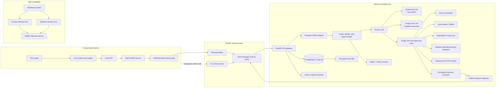

# Project Hermes Architecture Blueprint

**Author:** Manus AI  
**Status:** Starter implementation blueprint  
**Reviewed:** 2026-08-21

Project Hermes is a privacy-first, locally hosted voice-assistant platform. The design keeps inference, orchestration, and sensitive state on a user-controlled Linux host. Remote access is an authenticated overlay-network concern rather than an application feature: the FastAPI service binds to loopback and a host-managed Tailscale proxy provides controlled ingress. This avoids granting a Docker container control over the network daemon.

> **Cryptographic boundary.** Hermes never claims that a custom Python wrapper is an implementation of Signal Protocol. The reference implementation stores payloads at rest using AES-256-GCM and an Argon2id-derived key, while transport-level end-to-end encryption is a replaceable client/sidecar interface. A production Signal-compatible double-ratchet deployment requires a pinned official TypeScript/Node sidecar, protocol test vectors, and an independent security review.[1]

## Data flow

The API gateway accepts only authenticated client sessions, evaluates a capability policy, and submits background jobs to the worker queue. It does not send arbitrary prompts directly to tools. The Router LLM produces a structured route decision; the policy layer then validates the requested tool, destination, scope, and whether a human approval is required. The local LLM endpoint is accessed only on the local network through Ollama-compatible HTTP APIs.

| Zone | Components | Inbound rule | Outbound rule | Security control |
| --- | --- | --- | --- | --- |
| Client | Wake word, STT, client keys | Local microphone only | Tailscale by default | Client owns session secrets; device authorization is explicit. |
| Ingress | Tailscale Serve/Services, optional onion proxy | Tailnet ACL or Tor-authenticated admin only | `127.0.0.1:8000` | No public API port; mTLS/Tailscale identity remains outside containers. |
| API | FastAPI, policy engine, plugin registry | Loopback reverse proxy only | Local Ollama, Redis, Postgres | Short-lived sessions, immutable audit trail, deny-by-default capabilities. |
| Worker | Celery, browser/mail/media integrations | Redis private network only | Allow-listed targets only | Separate service account, bounded retries, approval tokens. |
| State | PostgreSQL/SQLite, encrypted files, Vault | Private Docker network only | None by default | AES-256-GCM records, Argon2id root-key derivation, key rotation plan. |
| Operations | Heartbeat, Tailscale status wrapper | Host local socket/CLI only | Tailscale control plane | Read-only status commands, finite timeouts, fail-closed health checks. |

## Routing and local-first operation

The router has only two decisions: `fast` and `reasoning`. A small model receives simple intent classification such as lights, timers, and media playback. A larger local model is selected only for complex planning, summarization, or multi-step tasks. Tool calls are supplied through a narrow JSON schema; tools never receive the full free-form conversation unless their policy explicitly allows it.

Core local functions remain available when WAN access fails: wake word detection, speech-to-text, routing, home automation, local-media control, and local TTS. Internet-dependent integrations remain disabled rather than silently falling back to another path. The target wake-word latency is a performance requirement to benchmark on actual hardware, not a guaranteed software property; a measured latency budget must include microphone buffering, wake-word detection, process scheduling, and device load.

## Access and high availability

Tailscale Services provides a stable MagicDNS name and TailVIP that can steer to multiple available tagged hosts; it is preferable to a floating-IP script for a tailnet-only TCP service.[2] Each host should advertise the same service using a tag-based identity, then administrators can approve hosts or use a narrowly scoped auto-approval policy.[2] The host-managed `tailscale serve` command exposes loopback HTTP safely within the tailnet and can report its configuration as JSON for health checks.[3]

The Docker Compose sample does not run Tailscale itself. On each host, use an approved host configuration such as `tailscale serve --service=svc:hermes-api --https=443 127.0.0.1:8000`, adjusted to the deployed topology. Keep application containers on a private network and only publish the API port to `127.0.0.1`.

| Failure | Detection | Safe response | Recovery |
| --- | --- | --- | --- |
| Router model unavailable | Local health endpoint fails three consecutive checks | Mark route unavailable; do not forward prompts externally | Restart local model service and re-run health check. |
| Primary host unavailable | Heartbeat threshold exceeded | Drain/remove primary service advertisement; preserve queued jobs | Promote already synchronized standby and re-advertise service. |
| Tailscale unavailable | Status wrapper cannot verify backend state | Keep local features available; close remote ingress | Require administrator remediation; onion dashboard is emergency-only. |
| Tor proxy unavailable | SOCKS health probe fails | Disable Tor-routed connector jobs; do not fall back to clearnet | Restore Tor, validate exit policy, then explicitly re-enable. |
| Secret backend unavailable | Vault/env verification fails | Reject external tools and management operations | Restore secret backend and rotate affected credentials if needed. |

## Extensions and safety constraints

Plugins implement the `BasePlugin` contract and declare a manifest that contains their capability set, whether they need approval, required secrets, and their allowed outbound domains. Hot reload is restricted to signed or locally operator-installed packages; production mode only reloads after a manifest and capability-policy validation. The future `StockTrader` placeholder may describe market information, but it must not execute trades without a separately designed approval and risk-control system.

The browser integration is intentionally an operator-attended form assistant. It may automate an approved first-party page with user-provided data, but it stops before CAPTCHA, payment, final account submission, verification code, or 2FA steps. It neither employs stealth/evasion nor attempts to circumvent a website's controls. The current `playwright-stealth` package itself describes its technique as a proof-of-concept aimed at masking basic bot-detection signals; it is excluded from Hermes.[4]

The Tor components remain separate, opt-in, and disabled by default. An onion endpoint is suitable for a locked-down emergency administration surface, but it should not be an unaudited general API entrance. Scraping tasks must have an approved target/domain policy and honor applicable site rules; the supplied starter contains no crawling or anti-detection functionality.

## References

[1] [Signal — `libsignal` repository](https://github.com/signalapp/libsignal)  
[2] [Tailscale Services documentation](https://tailscale.com/docs/features/tailscale-services)  
[3] [Tailscale `serve` command reference](https://tailscale.com/docs/reference/tailscale-cli/serve)  
[4] [PyPI — `playwright-stealth` 2.0.3](https://pypi.org/project/playwright-stealth/)
