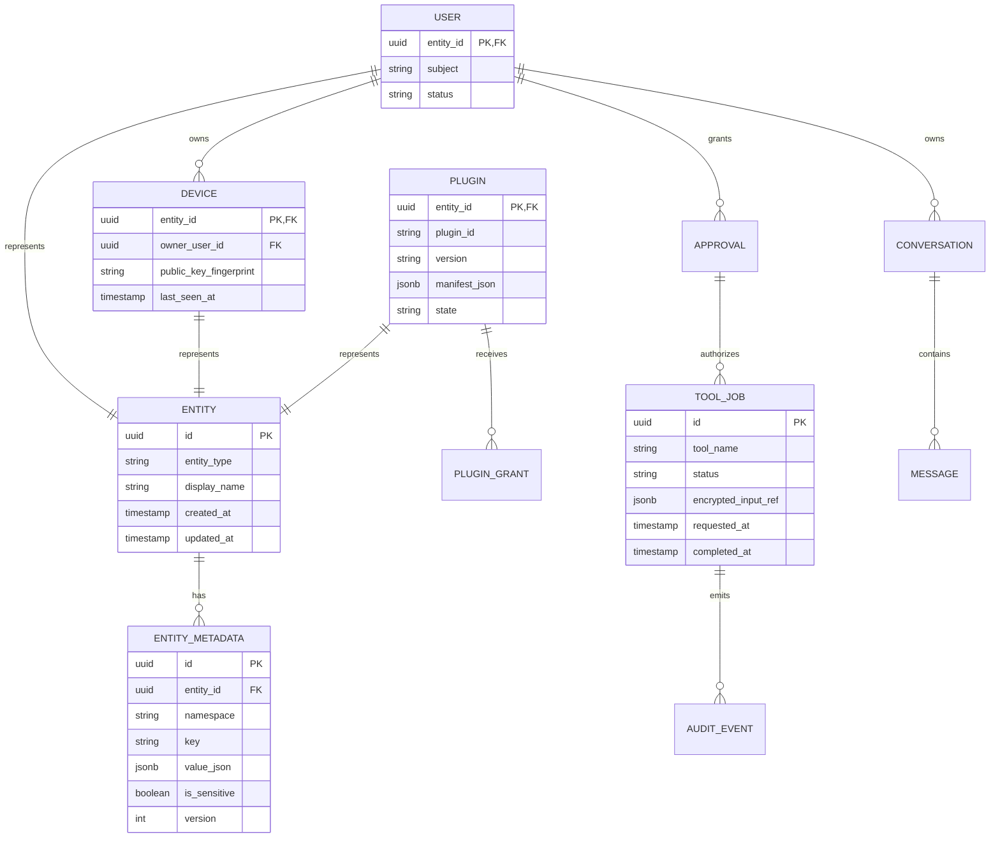

# Database Schema and Metadata Model

Hermes uses PostgreSQL in production and supports SQLite only for single-host development. The schema separates first-class entities from extensible metadata so plugins cannot add opaque ad hoc columns to core tables. Every mutable record has creation and update timestamps; sensitive values are stored only as encrypted records or secret references.

| Table | Purpose | Primary controls |
| --- | --- | --- |
| `entities` | Stable polymorphic identity for people, devices, and plugins. | Immutable entity type after creation; UUID primary key. |
| `entity_metadata` | Versioned, namespace-scoped metadata for any entity. | Unique `(entity_id, namespace, key)`; sensitive values are encrypted before persistence. |
| `users` | Local operator identity and policy subject. | Maps one-to-one to `entities`; no external-password storage. |
| `devices` | Enrolled clients and public-key fingerprints. | Revocation state, device binding, last-seen timestamp. |
| `plugins` | Installed plugin manifests and capability grants. | Manifest hash; enabled state; explicit capability grants. |
| `tool_jobs` | Idempotent records for background tool execution. | Encryption reference for arguments; approval ID; bounded retry state. |
| `approvals` | Short-lived human authorizations. | One-time token hash, action scope, expiration, operator identity. |
| `audit_events` | Append-only events for all tool and admin actions. | Request ID, actor, outcome, tamper-evident hash chain in production. |
| `conversations` and `messages` | Optional encrypted conversation state. | Ciphertext only; key version and nonce recorded per item. |

> **Sensitive metadata rule.** `entity_metadata.value_json` must never contain unencrypted credentials, full email bodies, audio, or raw private keys. Store a ciphertext envelope or a secret-manager reference instead.

A production deployment should add migration tooling, row-level authorization in the application service, daily encrypted backups, restore drills, and a retention policy for jobs/audit data. SQLite is not an HA database and should never be shared simultaneously by the primary and standby hosts.
